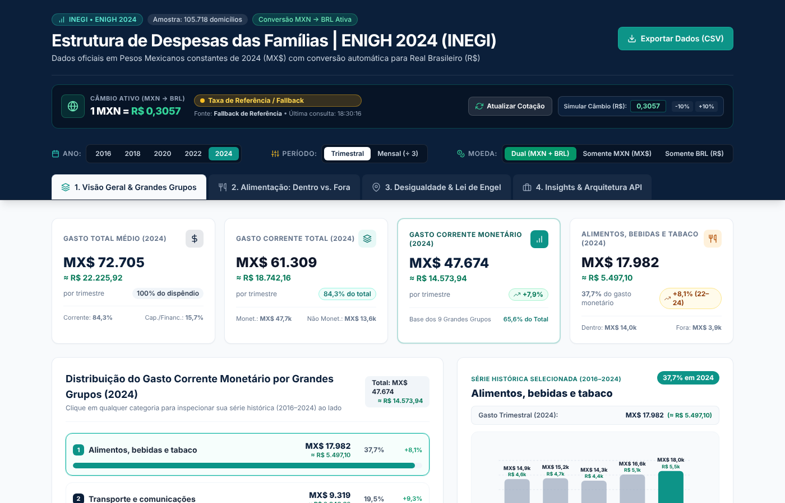

# Dashboard ENIGH 2024 (INEGI, México)

Dashboard interativo sobre a estrutura de despesas das famílias mexicanas, com dados oficiais da **Encuesta Nacional de Ingresos y Gastos de los Hogares 2024 (ENIGH, INEGI)** e conversão de moeda MXN → BRL em tempo real.



**Demo:** `https://SEU-USUARIO.github.io/NOME-DO-REPOSITORIO/` *(preencher depois de ativar o GitHub Pages)*

## Problema

Os resultados da ENIGH vêm em apresentações e tabelas em PDF, em espanhol e em pesos mexicanos. Isso dificulta comparar anos, ver o peso de cada categoria e entender os números para quem está no Brasil.

## Solução

Um dashboard em React que organiza os dados da ENIGH 2016–2024 em quatro seções:

1. **Visão geral e grandes grupos:** gasto total, corrente e monetário, com a distribuição por categoria e a série histórica de cada uma.
2. **Alimentação, dentro vs. fora do lar:** subgrupos de alimentos e variação entre 2016 e 2024.
3. **Desigualdade e Lei de Engel:** comparação entre decis de renda e entre estados.
4. **Insights e arquitetura da API:** leitura dos resultados e explicação de como a cotação é obtida.

Recursos: filtro por ano, alternância entre valores trimestrais e mensais, exibição em MXN, BRL ou ambos, simulação manual de câmbio e exportação em CSV.

### Câmbio com fallback

A cotação MXN → BRL é buscada em cadeia, para o dashboard nunca ficar sem valor:

1. `open.er-api.com` (principal)
2. `api.frankfurter.app` (secundária, se a primeira falhar ou passar de 5 s)
3. Taxa fixa de referência (R$ 0,3057), usada se as duas APIs falharem

O painel mostra de onde veio a taxa e o horário da consulta.

## Ferramentas

- React 18, Vite 5 e Tailwind CSS 3
- Ícones SVG inline (sem biblioteca externa de ícones ou gráficos)
- APIs públicas de câmbio (sem chave de acesso)
- Dados: INEGI, ENIGH 2024 (apresentação de resultados, julho de 2025)

## Resultado

- Dados de 5 edições (2016, 2018, 2020, 2022 e 2024) em um só lugar, com o gasto exibido em MXN e BRL
- Build de produção com cerca de 65 kB de JavaScript comprimido
- Conferência manual dos números principais contra a fonte (ver abaixo)

### Validação dos dados

Os valores dos cards de 2024 foram comparados com a apresentação oficial do INEGI:

| Indicador (trimestral, por hogar) | Dashboard | INEGI |
| --- | --- | --- |
| Gasto total | MX$ 72.705 | 72 705 |
| Gasto corrente total | MX$ 61.309 | 61 309 |
| Gasto corrente monetário | MX$ 47.674 | 47 674 |
| Alimentos, bebidas e tabaco | MX$ 17.982 | 17 982 |
| Dentro + fora do lar + tabaco | 14.004 + 3.896 + 82 = 17.982 | 17 982 |
| Participação de alimentos no gasto monetário | 37,7 % | 37,7 % |

Os valores estão em pesos constantes de 2024. Os dados foram transcritos da apresentação (PDF) e não de microdados.

## Como rodar
Descompactar node_modules.zip.
Requer Node.js 18 ou mais novo.

```bash
npm install
npm run dev      # abre em http://localhost:4173
npm run build    # gera a pasta dist/
```

Não há variáveis de ambiente nem chaves de API.


## Limitações e próximos passos

- Os dados estão embutidos no código (tabelas da apresentação do INEGI), não são lidos de uma base. Um próximo passo é gerar JSONs a partir das tabelas oficiais ou dos microdados.
- A ENIGH é uma pesquisa por amostra, feita a cada dois anos. Não mostra preços ao longo do tempo.
- A conversão para reais usa a cotação do dia sobre valores de 2024, o que serve para dar ordem de grandeza e não para comparação monetária exata.
- Insights escritos de forma estática. Dá para evoluir para insights gerados por IA a partir dos agregados.

## Segurança e privacidade

- Nenhum dado pessoal: apenas estatísticas agregadas públicas.
- Nenhuma chave de API no código. As APIs de câmbio são públicas e chamadas direto do navegador.
- O código não envia dados do usuário a nenhum serviço.

## Uso de IA no desenvolvimento

Gemini, Manus e acabamento realizado no Claude.

## Fonte

INEGI. *Encuesta Nacional de Ingresos y Gastos de los Hogares (ENIGH) 2024.* https://www.inegi.org.mx/programas/enigh/nc/2024/
